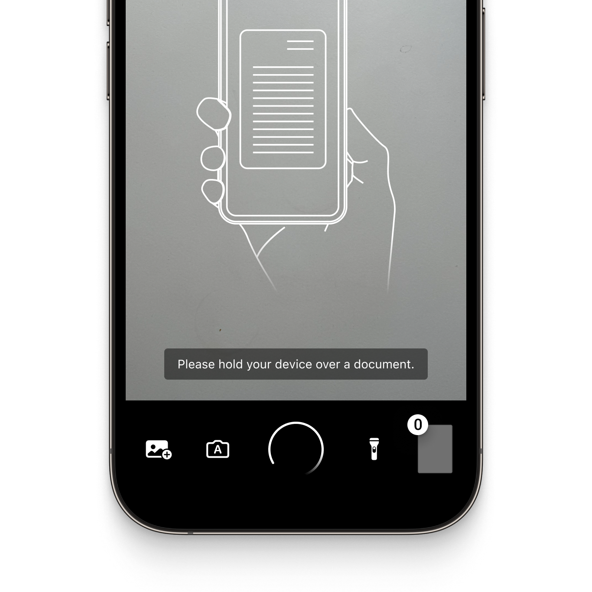
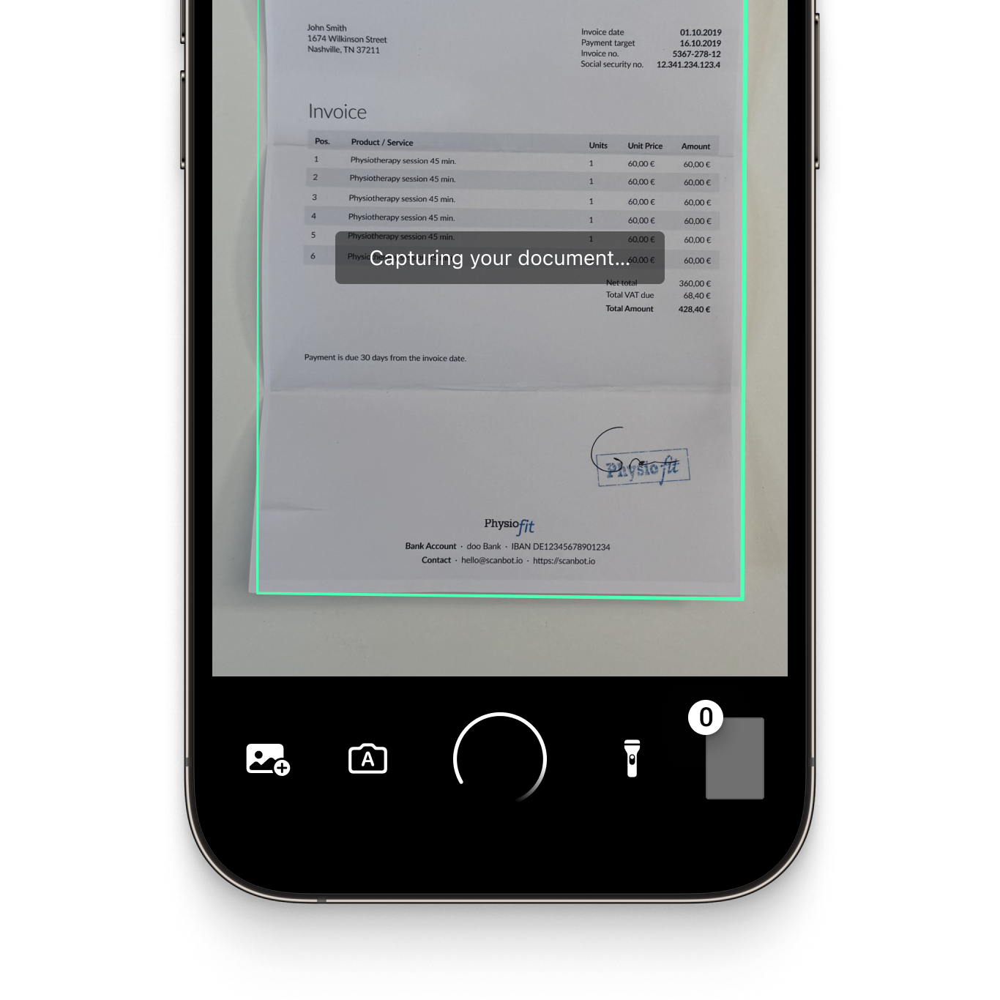
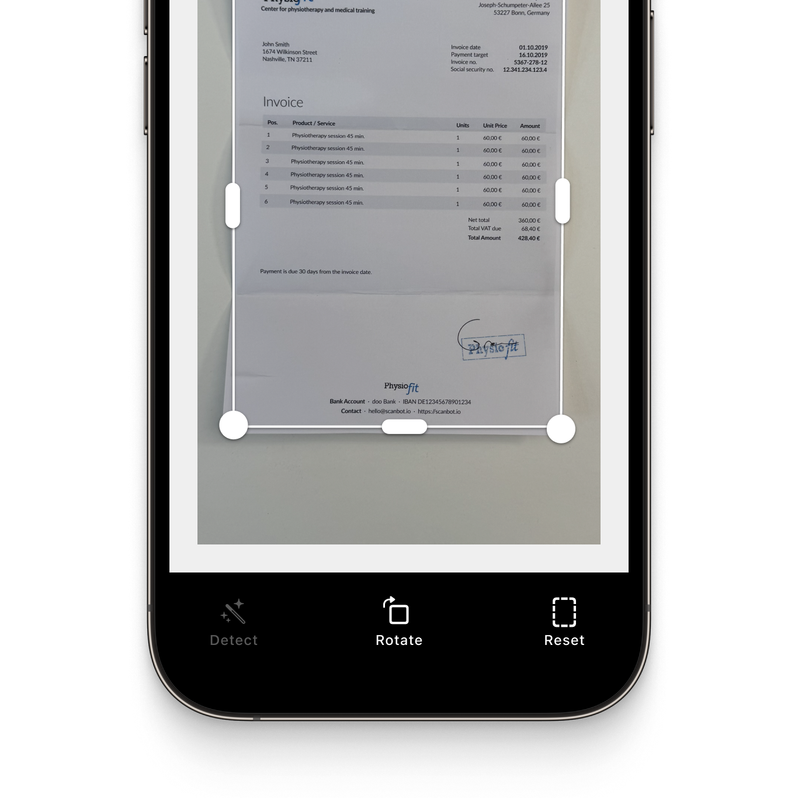
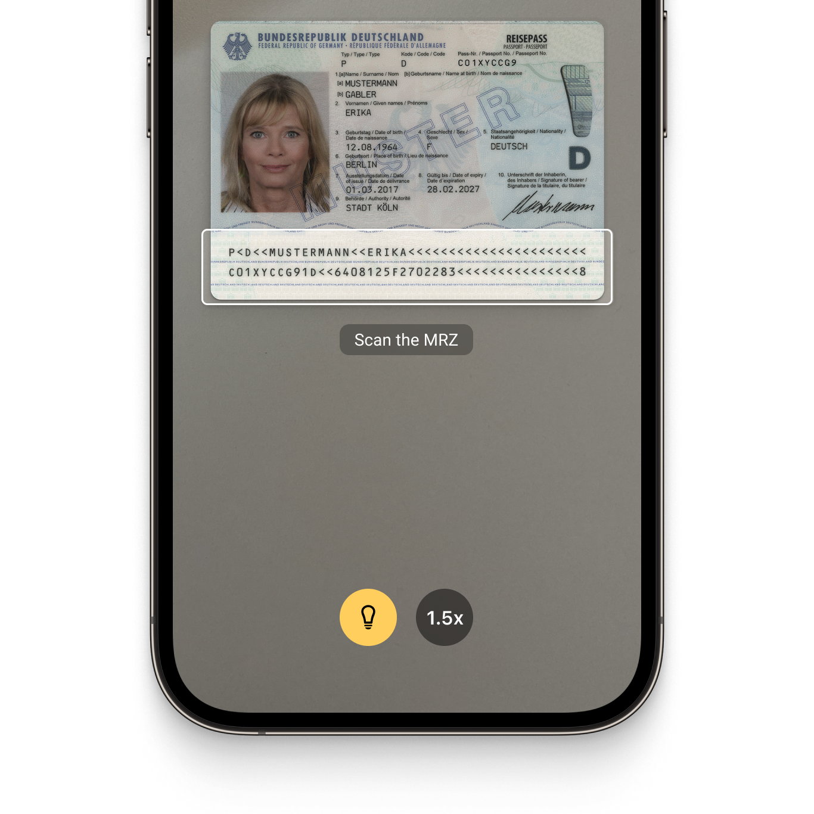
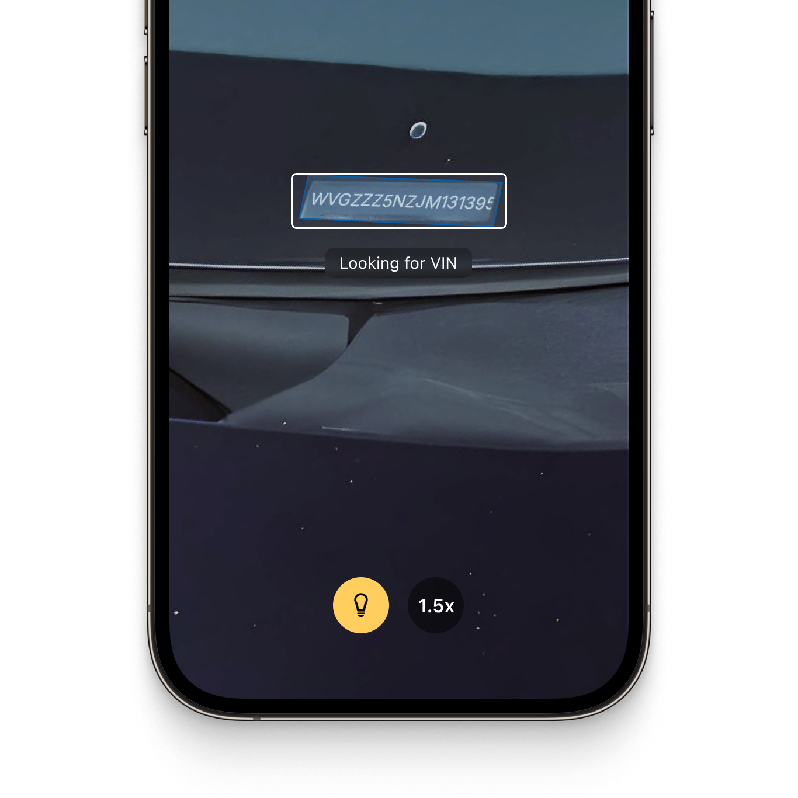
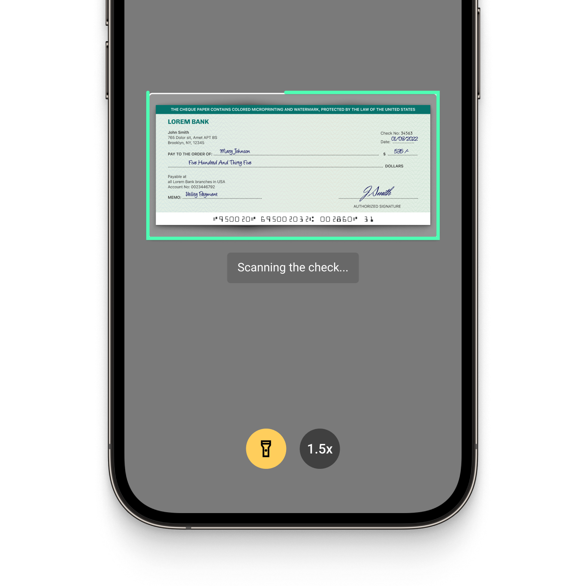

# Thai OCR → Searchable PDF (React Native)

A small pipeline, built on top of the Scanbot React Native SDK, that takes a PDF of
scanned Thai-language pages and produces either (a) the recognized Thai text, or
(b) a **searchable PDF** that looks identical to the original but carries a selectable,
Ctrl+F-able Thai text layer.

The point of the exercise: Thai is a non-Latin script, so the fast Latin-only engine
(`SCANBOT_OCR`) can't read it. This uses the **Tesseract** engine with Thai trained
data (`tha.traineddata`) instead.

## How the pipeline works

Both flows start by rasterizing the PDF to page images, then diverge:

```
                    ┌─ recognizeOnImages (Tesseract, 'tha') ─────────► recognized text  → .txt
PDF ─ extractImageFiles ─► page images ─┤
                    └─ generateFromImages (pageSize CUSTOM, Tesseract 'tha') ─► searchable PDF
```

Code lives in [`src/codeSnippets/document/result-handling/ocr-msig.ts`](src/codeSnippets/document/result-handling/ocr-msig.ts),
wired to the UI in [`src/screens/OcrTestScreen.tsx`](src/screens/OcrTestScreen.tsx).

1. **Rasterize.** `ScanbotPdfImageExtractor.extractImageFiles({ pdfFileUri })` renders each
   PDF page to an image and returns a `string[]` of image file URIs. (The source PDF is
   treated as a scan — any existing text layer is ignored; recognition runs on pixels.)
2. **Text path** — `ocrPdfThaiExample()`:
   `ScanbotOcrEngine.recognizeOnImages({ images, configuration: { engineMode: 'TESSERACT', languages: ['tha'] } })`
   returns `recognizedText`, saved to `msig_ocr.txt`.
3. **Searchable-PDF path** — `ocrSearchablePdfThaiExample()`:
   `ScanbotPdfGenerator.generateFromImages({ images, pdfConfiguration: { pageSize: 'CUSTOM', pageDirection: 'AUTO' }, ocrConfiguration: { engineMode: 'TESSERACT', languages: ['tha'] } })`
   returns a new PDF with an invisible Thai text layer over each page. `pageSize: 'CUSTOM'`
   keeps every page at the original scan's dimensions instead of forcing A4.

### The OCR engine and language data

- Engine: **Tesseract** (`engineMode: 'TESSERACT'`), which supports non-Latin scripts.
- Thai data: `tha.traineddata`, bundled at
  `android/app/src/main/assets/ocr_blobs/` (Android) and
  `ios/ScanbotSDKOCRData.bundle/` (iOS). On init the SDK copies these into its runtime
  tessdata directory; `ScanbotSDK.getOcrConfigs()` then reports the installed languages
  (e.g. `de, en, th`) and the data path.
- Note the code conventions: the API wants the 3-letter Tesseract code (`tha`), while
  `getOcrConfigs()` reports the 2-letter ISO code (`th`). Same language.

## Prerequisites

- A Scanbot SDK license key. The committed key is a placeholder
  (`YOUR_SCANBOT_LICENSE_KEY` in [`App.tsx`](App.tsx)). Get a free trial at
  <https://docs.scanbot.io/trial/>, generated for the app identifier that matches this
  app's Android `applicationId` / iOS bundle id (here: `com.thaiocr`). The key is bound
  to that identifier exactly, or init fails with `FAILURE_APP_ID_MISMATCH`.
- `tha.traineddata` present in the asset folders above (included in this repo).

## Running it (Android)

The three buttons live under **OCR PDF (Thai)** on the home screen.

```bash
# 1. Push a test PDF into the app's external files dir
adb push src/files/MSIG.pdf /sdcard/Android/data/com.thaiocr/files/MSIG.pdf

# 2. Build + install (invoking Gradle directly is more reliable than the RN CLI on Windows)
cd android && ./gradlew.bat app:installDebug   # ./gradlew on macOS/Linux
cd ..

# 3. Metro tunnel, then launch
adb reverse tcp:8081 tcp:8081
npx react-native start           # in one terminal
adb shell monkey -p com.thaiocr -c android.intent.category.LAUNCHER 1

# 4. Tap "Make searchable Thai PDF from MSIG.pdf", then pull the result
adb pull /sdcard/Android/data/com.thaiocr/files/MSIG_searchable.pdf ./MSIG_searchable.pdf
```

Gotchas worth knowing, all learned the hard way:

- **Launch with `monkey`, not `am start`.** This app's `applicationId` (`com.thaiocr`)
  differs from its `namespace` (`io.scanbot.example.sdk.reactnative`), so
  `am start com.thaiocr/.MainActivity` fails — the activity class isn't under that package.
- **Emulator RAM.** Tesseract on full-resolution pages allocates ~500 MB. On a 2 GB AVD
  the kernel's low-memory killer terminates the (foreground) app mid-OCR, which looks like
  a silent crash with no stack trace. Give the emulator ~4 GB.
- **Recognition quality** depends on the scan's resolution. On a low-res source the Thai
  output has errors; raising the page-extraction DPI before OCR is the main lever.

---

_This project is built on the Scanbot SDK React Native example app. The original sample
README follows._

<p align="left">
  
</p>
<p align="left">
  
</p>

# Example app for the Scanbot React Native Document Scanner SDK and Data Capture Modules

This example app demonstrates how to integrate the [Scanbot Document Scanner SDK](https://scanbot.io/document-scanner-sdk/?utm_source=github.com&utm_medium=referral&utm_campaign=dev_sites) and [Scanbot Data Capture Modules](https://scanbot.io/data-capture-software/?utm_source=github.com&utm_medium=referral&utm_campaign=dev_sites) for React Native.

## What is the Scanbot SDK?

The Scanbot SDK is a set of high-level APIs that lets you integrate document scanning and data extraction functionalities into your mobile apps and websites. It runs on all common mobile devices and operates entirely offline. No data is transmitted to our or third-party servers.

With our Ready-To-Use UI (RTU UI) components, you can integrate the Scanbot SDK into your React Native app in less than an hour.

💡 For more details about the Scanbot Document Scanner SDK and Data Capture Modules, please check out our [documentation](https://docs.scanbot.io/react-native/document-scanner-sdk/introduction/?utm_source=github.com&utm_medium=referral&utm_campaign=dev_sites).

## How to run this example app?

### Set up the Environment

> **Note**: Make sure you have completed the [Set Up Your Environment](https://reactnative.dev/docs/set-up-your-environment) guide before proceeding.

Testing on an actual device is essential, so ensure you have one available, for both iOS or Android platforms.

### Install node modules 
```bash 
# Install the required dependencies
yarn install

# OR using npm
npm install
```

### Prepare iOS

For iOS, remember to install CocoaPods dependencies (this only needs to be run on first clone or after updating native deps).

The first time you create a new project, run the Ruby bundler to install CocoaPods itself:

```sh
bundle install
```

Then, and every time you update your native dependencies, run:

```sh
cd ios 
bundle exec pod install
```

### Signing

* Open the **workspace** file `ScanbotBarcodeExampleReact.xcworkspace` (not .xcodeproj) from the `iOS` directory in Xcode.

* Adjust *Provisioning* and *Signing* settings.

Also, ensure that your app correctly handles the **camera permission request** in the Info.plist file to allow barcode and document scanning.

### Run on Android

```
# Using npm
npm run android

# OR using Yarn
yarn android
```

### Run on iOS

```
# Using npm
npm run ios

# OR using Yarn
yarn ios
```

If everything is set up correctly, you should see your new React Native app running on your device.

This is not the only way to run your app — you can also run it directly from within Android Studio and Xcode respectively:

#### Troubleshooting

If you experience any issues, it's likely a cache problem. To clear it, run:

```
yarn run clean
```

* `npm cache clean --force && watchman watch-del-all`
* Then, restart the metro server, and your React Native document scanner should be working smoothly again.

## Overview of the Scanbot SDK

### Document Scanner SDK

The Scanbot React Native Document Scanner SDK offers the following features:

* **User guidance**: Ease of use is crucial for large user bases. Our on-screen user guidance helps even non-tech-savvy users create perfect scans under any conditions, even with decreased camera brightness. This feature ensures that documents are properly framed and aligned before the scan is taken, ensuring the best quality of the captured image.

* **Automatic capture**: The SDK automatically captures the scan when the device camera is optimally positioned over the document. This minimizes blurry or incomplete scans.

* **Automatic cropping**: Our SDK automatically applies perspective correction and crops scanned documents, ensuring a properly cropped image every time.

* **Custom image filters:** Every use case has specific image requirements. The SDK’s custom filters allow you to transform the captured image into optimal input for your backend systems. They include several color, grayscale, and binarization options.

* **Document Quality Analyzer:** This feature automatically rates the quality of the scanned pages from “very poor” to “excellent.” If it is low, it can prompt the user to rescan.

* **Export formats:** The Scanbot React Native Document Scanner SDK supports several formats for exporting digitized documents (JPG, PDF, TIFF, and PNG).

|  |  |  |
| :-- | :-- | :-- |


### Data Capture Modules

The Scanbot SDK Data Capture Modules allow you to extract data from a wide range of structured documents and to integrate OCR text recognition capabilities. They include:

#### [MRZ Scanner](https://scanbot.io/data-capture-software/mrz-scanner/?utm_source=github.com&utm_medium=referral&utm_campaign=dev_sites) 
This module allows quick and accurate data extraction from the machine-readable zones on identity documents. It captures all important MRZ data from IDs and passports and returns it in the form of simple key-value pairs. This is much simpler, faster, and less mistake-prone than manual data entry.

#### [Check Scanner (MICR)](https://scanbot.io/data-capture-software/check-scanner/?utm_source=github.com&utm_medium=referral&utm_campaign=dev_sites)
The MICR Scanner offers reliable data extraction from international paper checks, capturing check numbers, routing numbers, and account numbers from MICR codes. This simplifies workflows and reduces errors that frustrate customers and employees.

#### [Text Pattern Scanner](https://scanbot.io/data-capture-software/data-scanner/?utm_source=github.com&utm_medium=referral&utm_campaign=dev_sites)
Our Text Pattern Scanner allows quick and accurate extraction of single-line data. It captures information based on customizable patterns tailored to your specific use case. This replaces error-prone manual data entry with automatic capture.

#### [VIN Scanner](https://scanbot.io/data-capture-software/vin-scanner/?utm_source=github.com&utm_medium=referral&utm_campaign=dev_sites)
The VIN scanner enables instant capture of vehicle identification numbers (VINs) from trucks or car doors. It uses OCR to convert the image of the VIN code into structured data for backend processing. This module integrates into mobile or web-based fleet management applications, enabling you to replace error-prone manual entry with fast, reliable data extraction.

#### Document Data Extractor
Through this feature, our SDK offers document detection and data capture capabilities for a wider range of documents. It accurately identifies and crops various standardized document types including [German ID cards](https://scanbot.io/data-capture-software/id-scanner/?utm_source=github.com&utm_medium=referral&utm_campaign=dev_sites), passports, [driver's licenses](https://scanbot.io/data-capture-software/german-drivers-license-scanner/?utm_source=github.com&utm_medium=referral&utm_campaign=dev_sites), [residence permits](https://scanbot.io/data-capture-software/residence-permit-scanner/?utm_source=github.com&utm_medium=referral&utm_campaign=dev_sites), and the [EHIC](https://scanbot.io/data-capture-software/ehic-scanner/?utm_source=github.com&utm_medium=referral&utm_campaign=dev_sites). It uses the Scanbot OCR engine for accurate data field recognition, without requiring additional OCR language files.

|  |  |  |
| :-- | :-- | :-- |

## Additional information

### Trial license and pricing 

The Scanbot SDK examples will run for one minute per session without a license. After that, all functionalities and UI components will stop working. 

To try the Scanbot React Native SDK without the one-minute limit, you can request a free, no-strings-attached [7-day trial license](https://docs.scanbot.io/trial/?utm_source=github.com&utm_medium=referral&utm_campaign=dev_sites) for your React Native project.

Alternatively, check out our [demo apps](https://scanbot.io/demo-apps/?utm_source=github.com&utm_medium=referral&utm_campaign=dev_sites) to test the SDK.

Our pricing model is simple: Unlimited document scanning for a flat annual license fee, full support included. There are no tiers, usage charges, or extra fees. [Contact](https://scanbot.io/contact-sales/?utm_source=github.com&utm_medium=referral&utm_campaign=dev_sites) our team to receive your quote.

### Other supported platforms

Besides React Native, the Scanbot Document Scanner SDK is also available on:

* [Android](https://github.com/doo/scanbot-sdk-example-android) (native)
* [iOS](https://github.com/doo/scanbot-sdk-example-ios) (native)
* [Flutter](https://github.com/doo/scanbot-sdk-example-flutter)
* [Capacitor & Ionic (Angular)](https://github.com/doo/scanbot-sdk-example-capacitor-ionic)
* [Capacitor & Ionic (React)](https://github.com/doo/scanbot-sdk-example-ionic-react)
* [Capacitor & Ionic (Vue.js)](https://github.com/doo/scanbot-sdk-example-ionic-vuejs)
* [Cordova & Ionic](https://github.com/doo/scanbot-sdk-example-ionic) 
* [.NET MAUI](https://github.com/doo/scanbot-sdk-maui-example)
* [JavaScript](https://github.com/doo/scanbot-sdk-example-web)
* [Xamarin](https://github.com/doo/scanbot-sdk-example-xamarin) & [Xamarin.Forms](https://github.com/doo/scanbot-sdk-example-xamarin-forms)

Our Barcode Scanner SDK additionally also supports [Compose Multiplatform / KMP](https://github.com/doo/scanbot-barcode-scanner-sdk-example-kmp), [UWP](https://github.com/doo/scanbot-barcode-scanner-sdk-example-windows) (Windows), and [Linux](https://github.com/doo/scanbot-sdk-example-linux).
